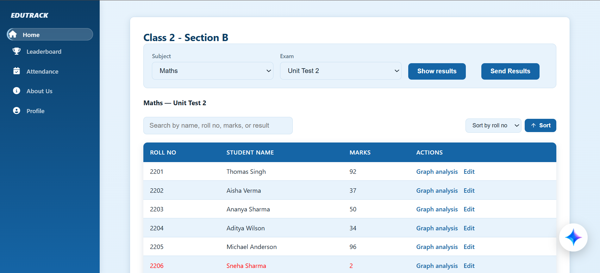
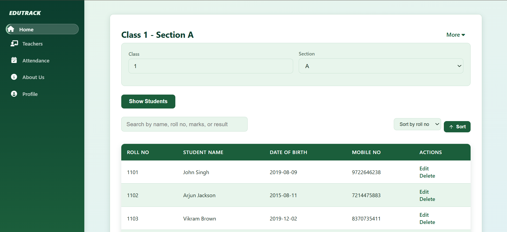
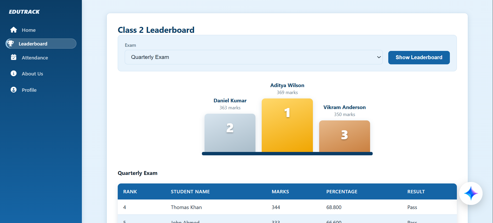
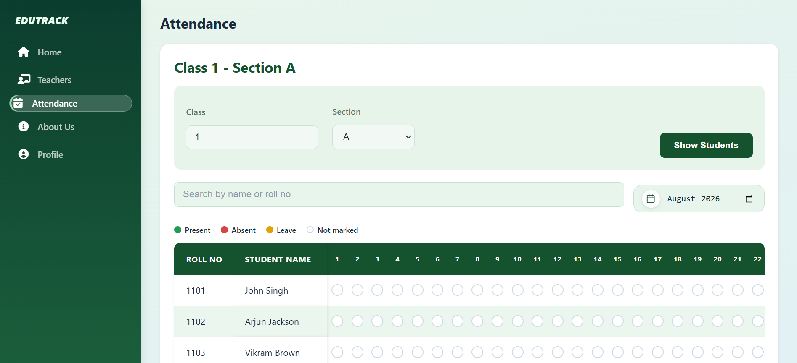
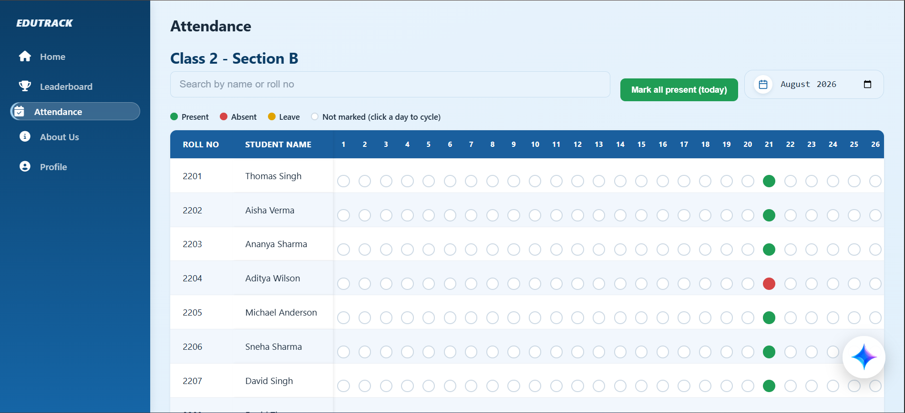
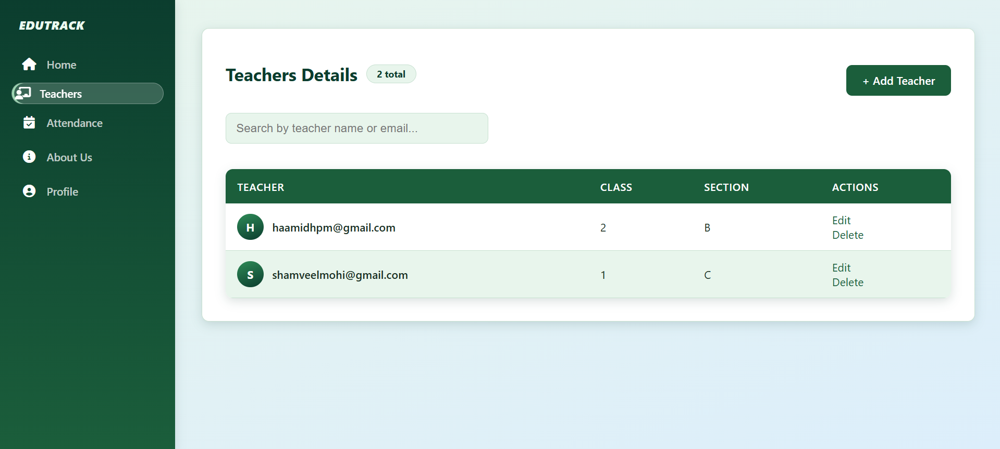

<p align="center"></p>

# Smart Mentor Connect

Smart Mentor Connect is a web-based student management and performance analysis platform designed to help schools manage students, teachers, examinations, marks, attendance, and academic performance through a centralized system.

## Features

* Teacher-side dashboard
* Management-side dashboard
* Student-side portal (read-only: own marks, graphs, attendance and class rank)
* Student information management
* Teacher management
* Marks management
* Attendance management
* Examination management
* Student performance analysis
* Performance charts and graphs
* Class leaderboard
* CSV student data import and export
* User authentication, including Face ID login
* AI-assisted student data interaction
* Email functionality
* Application logging

## Technologies Used

### Backend

* Python
* Flask
* MySQL
* SQLAlchemy

### Frontend

* HTML
* CSS
* JavaScript
* Font Awesome

### Libraries and Tools

* Pandas, NumPy
* Matplotlib, Seaborn
* OpenCV, Pillow
* MySQL Connector / PyMySQL
* Google Generative AI (Gemini)
* Git
* GitHub

## Project Structure

```text
Smart-Mentor-Connect/
│
├── teacher_side/
│   ├── app/
│   │   ├── routes/
│   │   └── __init__.py
│   ├── templates/
│   ├── static/
│   └── run_teacher.py
│
├── management_side/
│   ├── app/
│   │   ├── routes/
│   │   └── __init__.py
│   ├── templates/
│   ├── static/
│   └── run_management.py
│
├── student_side/
│   ├── app/
│   ├── templates/
│   ├── static/
│   └── run_student.py
│
├── shared/
│   ├── settings.py        (reads environment variables)
│   ├── app_factory.py
│   ├── extensions.py
│   ├── models/
│   ├── services/
│   └── utils/
│
├── sample_data/
├── tests/
│   ├── conftest.py
│   └── test_smart_mentor_connect_full.py
├── requirements.txt
├── create_databases.py    (manual, destructive reset)
├── .env.example
├── .gitignore
└── README.md
```

## Installation

### 1. Clone the repository

```bash
git clone https://github.com/haamidhcoder-bot/Smart-Mentor-Connect.git
```

### 2. Navigate to the project directory

```bash
cd Smart-Mentor-Connect
```

### 3. Create a virtual environment

```bash
python -m venv .venv
```

### 4. Activate the virtual environment

On Windows:

```bash
.venv\Scripts\activate
```

On macOS/Linux:

```bash
source .venv/bin/activate
```

### 5. Install the required dependencies

```bash
pip install -r requirements.txt
```

## Database Setup

Smart Mentor Connect uses MySQL as its database.

Both applications create the `schooldb` database and any missing tables on startup. Existing data is never dropped.

### Configuration (environment variables)

There is no `config.py`. Copy `.env.example` to `.env` (git-ignored) and fill it in, or export the variables in your shell. Real environment variables take priority over `.env`.

| Variable | Used by | Purpose |
|---|---|---|
| `MYSQL_PASSWORD` (`MYSQL_HOST`, `MYSQL_USER` optional) | both | MySQL login |
| `TEACHER_SECRET_KEY` | teacher side | Flask session key |
| `MANAGEMENT_SECRET_KEY` | management side | Flask session key (use a different value) |
| `STUDENT_SECRET_KEY` | student side | Flask session key (use a different value) |
| `GEMINI_API_KEY` | teacher side | AI assistant |
| `ADMIN1_EMAIL`, `ADMIN1_APP_PASSWORD` | both | Gmail sender for OTP and result emails |
| `ADMIN2_EMAIL`, `ADMIN2_APP_PASSWORD` | both | Gmail account that receives OTPs / sends log files |
| `TEACHER_PORT` (8000), `MANAGEMENT_PORT` (5000), `STUDENT_PORT` (9000), `FLASK_DEBUG` (0) | optional | Run settings |

(Optional) Populate the database with sample data:

```bash
python sample_data/populate_school_database.py
```

## Running the Application

Smart Mentor Connect is split into two separate Flask applications that run independently and share the same database. Activate the virtual environment first, then start each side from the project root.

Management side:

```bash
python management_side/run_management.py
```

Teacher side:

```bash
python teacher_side/run_teacher.py
```

Student side:

```bash
python student_side/run_student.py
```

Students sign in with their **roll number and date of birth** (the database has no student passwords). After 5 wrong attempts for a roll number, that roll number is locked for 5 minutes. The student side is read-only and only ever shows the logged-in student's own records.

The applications can then be accessed at:

```text
Management side: http://127.0.0.1:5000
Teacher side:     http://127.0.0.1:8000
Student side:     http://127.0.0.1:9000
```

## Testing

Smart Mentor Connect includes a pytest suite (`tests/test_smart_mentor_connect_full.py`) covering the shared decorators, teacher-side and management-side routes, and the shared services. It runs against isolated Flask apps with the database and other external services mocked, so it does not touch your real `schooldb` database, email account, Face ID files, or the AI API.

Install pytest (included in `requirements.txt`) and run the suite from the project root:

```bash
pytest -q
```

All tests should pass on a clean checkout.

## Teacher Side

The teacher side provides functionality for:

* Viewing students
* Managing marks
* Recording attendance
* Viewing examination results
* Analyzing student performance
* Viewing class rankings
* Monitoring academic progress

## Management Side

The management side provides functionality for:

* Managing students
* Managing teachers
* Managing classes and sections
* Managing examinations
* Monitoring attendance
* Viewing academic performance
* Managing school-related information

## Performance Analysis

Smart Mentor Connect provides several tools for analyzing academic performance, including:

* Student performance summaries
* Subject-wise marks
* Examination results
* Class rankings
* Performance graphs
* Attendance information

These features help teachers and management monitor student progress and make better academic decisions.

## CSV Import

Smart Mentor Connect supports importing student information using CSV files.

Example:

```csv
student_name,student_gmail,DOB,mobile_no
John Singh,JohnSingh@gmail.com,2019-08-09,9722646238
Arjun Jackson,ArjunJackson@gmail.com,2015-08-11,7214475883
Vikram Brown,VikramBrown@gmail.com,2019-12-02,8370735411
William Smith,WilliamSmith@gmail.com,2008-01-07,6721490718
```

## Security

Smart Mentor Connect follows security practices such as:

* Session-based authentication
* Protected routes
* Input validation
* CSV validation
* Secure credential management
* Prevention of unauthorized access

Sensitive information such as passwords, API keys, and secret keys should be stored outside the source code.

## AI Assistance

Smart Mentor Connect includes an AI-assisted interface for interacting with student data and obtaining useful information from the school's database.

## Email Functionality

The application supports email functionality for system-related communication, including OTP-based password resets, sending generated files, and notifications.

## Screenshots

### Login Page


### Teacher Dashboard


### Management Dashboard


### Leaderboard


## Attendance Management



## Attendance Teacher



## Teachers Data


## AI Assistance


## Contributing

Contributions are welcome.

1. Fork the repository.
2. Create a new branch:

```bash
git checkout -b feature/your-feature
```

3. Make your changes.
4. Commit your changes:

```bash
git commit -m "Add your feature"
```

5. Push the branch:

```bash
git push origin feature/your-feature
```

6. Create a Pull Request.

## License

This project is licensed under the MIT License.

## Author

**Haamidh Mohideen**

GitHub: `https://github.com/haamidhcoder-bot`
